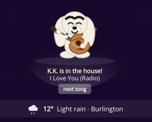
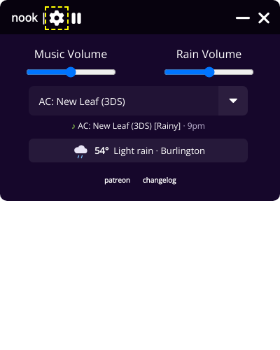
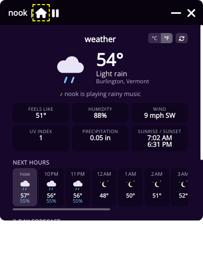
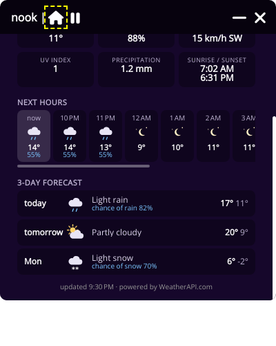

# Nook Desktop

<p align="center">
  
</p>

<p>Hi there! Google Chrome is releasing a new version of the extension manifest which makes extensions like Nook impossible/very inconvenient to use. So, I've created a desktop version of the app with a bunch of new features.</p>
<p>I've added the following:</p>
<ul>
    <li>New slick interface</li>
    <li>New rain sounds (in-game, no-thunder)</li>
    <li>Town tunes (and customization)</li>
    <li>Multilingual support (EN, ES, DE, IT, FR and CN for now)</li>
    <li>Offline mode</li>
    <li>Population growing snowy and cherry blossom themes</li>
    <li>New horizons rainy and snowy themes</li>
    <li>Pocket camp themes</li>
    <li>Random mode</li>
    <li>All K.K. songs released</li>
</ul>

## This fork

<p align="center">
  
</p>

<ul>
    <li><strong>Realtime weather sync</strong> – with a free <a href="https://www.weatherapi.com/">WeatherAPI.com</a> key, Nook looks up the weather where you are and plays the rainy or snowy version of your chosen game's soundtrack. Random mode only picks fitting games, and the rain ambience only plays when it is actually raining.</li>
    <li><strong>Weather report</strong> – the home page shows a weather strip; click it for current conditions, the next 12 hours and a 3-day forecast, in °C or °F.</li>
    <li><strong>K.K. on stage</strong> – whenever K.K. music is on (Saturday nights, or when you pick him) he sits on the home page and plays his guitar, with a next-song button.</li>
    <li><strong>Now playing</strong> – the home page shows which game and track is on.</li>
</ul>

<p align="center">
  
  
  
</p>

### Realtime weather setup

1. Create a free account at <a href="https://www.weatherapi.com/signup.aspx">weatherapi.com</a> and copy your API key.
2. Open Nook's settings, paste the key into the WeatherAPI.com field and tick <em>Use realtime weather</em>.
3. Your location is detected from your IP address; nothing else is sent.

## Development

```
npm install
npm start            # run the app
npm test             # lint + unit tests
npm run screenshots  # drives the app through its pages with fixture data and saves PNGs to ./screenshots
```

The code is split into:

- `index.js` – Electron main process (windows, tray, privileged actions)
- `app/shared/` – pure logic shared by both windows: the game catalogue and weather mapping (unit tested in `test/`)
- `app/hidden/` – the invisible player window: `player.js` orchestrates `lib/audio.js`, `lib/library.js` (offline cache), `lib/weather.js`, `lib/tune.js` and `lib/settings.js`
- `app/main/` – the visible window: static markup in `index.html`, one module per concern in `js/`

Environment variables for development: `NOOK_FAKE_TIME`, `NOOK_WEATHER_FIXTURE`, `NOOK_AUDIO_FIXTURE`, `NOOK_USER_DATA` (see `app/hidden/lib/devOverrides.js` and `scripts/screenshots.env`).

<p>TODO:</p>
<ul>
  <li>Afford a windows certificate so there's no dodgy installation process</li>
  <li>Afford a macOS certificate and create a macOS build</li>
</ul>
